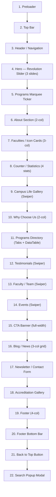

# Univet Website — Design Specification

> Complete design & architecture reference for the Univet university website template by RSTheme.

---

## Table of Contents

1. [Site Overview](#site-overview)
2. [Architecture & Tech Stack](#architecture--tech-stack)
3. [Page Structure & Sections](#page-structure--sections)
4. [Navigation](#navigation)
5. [Design System](#design-system)
   - [Color Palette](#color-palette)
   - [Typography](#typography)
   - [Spacing System](#spacing-system)
   - [Border Radius](#border-radius)
   - [Box Shadows](#box-shadows)
   - [Gradients](#gradients)
6. [Component Library](#component-library)
   - [Buttons](#buttons)
   - [Cards](#cards)
   - [Header & Navigation](#header--navigation)
   - [Footer](#footer)
   - [Forms](#forms)
   - [Icon Boxes](#icon-boxes)
   - [Counter/Stats](#counterstats)
   - [Tabs](#tabs)
7. [Animation System](#animation-system)
   - [AOS (Animate On Scroll)](#aos-animate-on-scroll)
   - [GSAP Animations](#gsap-animations)
   - [CSS Keyframe Animations](#css-keyframe-animations)
   - [Hover Effects](#hover-effects)
8. [Responsive Design](#responsive-design)
9. [Interactive Features](#interactive-features)
10. [Image & Asset Inventory](#image--asset-inventory)
11. [Content Structure](#content-structure)
12. [File Inventory](#file-inventory)

---

## Site Overview

| Property | Value |
|----------|-------|
| **Name** | Univet |
| **Type** | University / Higher Education Website |
| **Template By** | RSTheme |
| **CMS** | WordPress + Elementor (saved as static HTML snapshot) |
| **Title** | Home – Univet |
| **Location (fictional)** | University Ave, Toronto, ON M5S, Canada |
| **Tagline** | Empowering Future Leaders Through Education |

The site is a **single-page homepage** containing all major sections (hero, about, programs, campus, testimonials, events, blog, contact, footer). Navigation menu items link to sub-pages that exist as separate routes in the original WordPress installation but are not included in this static snapshot.

---

## Architecture & Tech Stack

### Platform
- **WordPress** — CMS engine
- **Elementor** — Page builder (all layout via Elementor widgets)
- **RSTheme Builder** — Custom theme framework layer on top of Elementor

### Frontend Libraries

| Library | Version | Size | Purpose |
|---------|---------|------|---------|
| jQuery | 3.x | 87 KB | Core DOM manipulation |
| GSAP | 3.x | 61 KB | Advanced animations |
| GSAP ScrollTrigger | — | 37 KB | Scroll-based animation triggers |
| GSAP SplitText | — | 15 KB | Character/word text splitting |
| GSAP TweenMax | Legacy | 114 KB | Legacy tweening engine |
| Swiper | Latest | 143 KB | Touch sliders & carousels |
| RS Swiper | — | 151 KB | RSTheme's extended Swiper |
| Revolution Slider 7 | 7.x | 340 KB + 209 KB | Hero slider & visual composer |
| DataTables | — | 116 KB | Sortable/filterable tables |
| Magnific Popup | — | 20 KB | Lightbox & modal popups |
| Odometer | — | 10 KB | Animated number counters |
| AOS | — | 14 KB | Animate On Scroll |
| Flatpickr | — | 50 KB | Date picker UI |
| jQuery Appear | — | 1.2 KB | Viewport detection |
| Parallax Effect | — | 17 KB | Mouse-driven parallax |
| Contact Form 7 | — | 1.4 KB | AJAX form handling |

### File Counts

| Type | Count | Total Size |
|------|-------|------------|
| HTML | 1 | ~450 KB |
| CSS | 48 | ~700 KB |
| JS | 35 | ~1.5 MB |
| Fonts | 9 | ~1.9 MB |
| Images | 109 | ~8 MB |

---

## Page Structure & Sections

The homepage is composed of **22 distinct sections**, rendered top-to-bottom:



### Section Details

#### 1. Preloader
- Full-screen overlay with university logo
- Fades out on `window.load`
- Prevents FOUC (flash of unstyled content)

#### 2. Top Bar (`.rs-topbar`)
- Background: **#0F5288** (primary blue)
- Left: Email (`info@univet.com`) + Location
- Right: Social icons (Facebook, Twitter, LinkedIn, YouTube, Instagram) + "Apply Now" button
- Height: ~40px, font-size: 13px, white text

#### 3. Header (`.rs-header`)
- White background, z-index: 999
- Logo (left): [logo-1-1-min.png](file:///d:/saveweb2zip-com-univet-rstheme-com/images/logo-1-1-min.png)
- Navigation (center): 8 primary menu items with dropdowns
- Right: Search icon + "Apply Now" CTA
- **Sticky behavior**: Fixed on scroll past ~250px with `box-shadow: 0 2px 15px rgba(0,0,0,0.1)` and `slideDown` animation
- Collapses to hamburger at **991px**

#### 4. Hero — Revolution Slider
- Full viewport width and height
- **3 rotating slides**, each with:
  - Full-bleed campus photography background
  - Dark gradient overlay: `rgba(15,82,136,0.9)` → `rgba(15,82,136,0.7)`
  - Animated subtitle → heading → paragraph → 2 CTA buttons
  - GSAP SplitText character-by-character heading reveal
- Navigation: Arrows + bullet pagination
- Autoplay with smooth transitions

#### 5. Academic Programs Marquee
- Dark background with white text
- GSAP-powered infinite horizontal scroll
- Program names separated by star/dot icons
- Programs: Engineering, Medicine, Business Administration, Computer Science, Arts & Humanities, Law, Architecture, etc.

#### 6. About Section
- **2-column layout**: Images (left) + Content (right)
- Left: Two overlapping images with decorative shape, experience badge ("30+ Years")
- Right: Section label → Heading ("Building Tomorrow's Leaders Today") → Description → 2 feature items (icons + text) → "Discover More" button
- AOS: `fade-up`, `fade-right`

#### 7. Faculties / Icon Cards
- Section title: "Our Faculties" / "Academic Excellence Across Disciplines"
- **3 cards** in a row with custom SVG icons:
  1. Faculty of Engineering
  2. Faculty of Medicine
  3. Faculty of Business
- Hover: card lifts + icon color swaps
- AOS with staggered 100/200/300ms delays

#### 8. Counter / Statistics
- **Blue gradient background**: `#0F5288` → `#003F7D`
- Parallax background scroll
- **4 counters** (Odometer-powered, triggered on viewport enter):

| Value | Label |
|-------|-------|
| 25,000+ | Students Enrolled |
| 1,200+ | Faculty Members |
| 350+ | Research Projects |
| 95% | Graduate Employment Rate |

#### 9. Campus Life Gallery
- Title: "Campus Life" / "Experience Our Vibrant Campus"
- Swiper carousel: 1 → 2 → 4 slides responsive
- Rounded images with hover zoom (`scale(1.05)`)
- Loop + autoplay

#### 10. Why Choose Us
- **2-column**: Content (left) + Image with signature (right)
- 4 feature checklist items:
  1. Globally Recognized Accreditation
  2. State-of-the-Art Research Facilities
  3. Industry-Connected Programs
  4. Diverse & Inclusive Community
- President signature image + name & title

#### 11. Programs Directory
- **Nested tabs**: Undergraduate | Graduate | Doctoral | Professional
- Each tab → **DataTable** with columns: Program Name, Department, Duration, Degree Type
- Searchable + sortable + paginated

#### 12. Testimonials
- Title: "What Students Say" / "Hear From Our Alumni"
- Swiper carousel: 1 → 2 → 3 slides
- Each card: Quote icon + testimonial text + student photo (circle) + name + program + 5-star rating
- Background: `testi-img-blue-min.jpg` with dark overlay
- Arrows + dots navigation

#### 13. Faculty / Team
- Title: "Our Faculty" / "Meet Our Distinguished Professors"
- Swiper: 1 → 2 → 4 slides
- Each card: Photo + Name + Department + Social links (hover overlay)

#### 14. Events
- Title: "Upcoming Events"
- Swiper carousel of event cards
- Each card: Image + date badge + title + location + time + description + "Read More"
- 4 events: Science Fair, Education Summit, Alumni Homecoming, Research Symposium

#### 15. CTA Banner
- Full-width background image (`call-2-min.jpg`) with dark overlay + parallax
- Heading: "Ready to Start Your Academic Journey?"
- 2 buttons: "Apply Now" (orange) + "Request Info" (outlined white)

#### 16. Blog / News
- Title: "Latest News" / "Stay Updated With University News"
- 3-column grid (Swiper on mobile)
- Each card: Featured image (zoom on hover) + category badge + date/author + title + excerpt + "Read More →"
- 4 posts: Research Center, Robotics Competition, Scholarships, Tech Partnership

#### 17. Newsletter / Contact
- 2-column: Form (left) + Image (right)
- Form: Email input + Subscribe button (Contact Form 7)
- Background: light blue tint `#EAF4FF`

#### 18. Accreditation Gallery
- Grid of accreditation body logos/images (9 items)
- 3-4 per row
- Magnific Popup lightbox on click

#### 19. Footer (`.rs-footer`)
- Background: `#0A0A0A`
- **4 columns**:
  1. About + white logo + social links
  2. Quick Links (6 items)
  3. Resources (6 items)
  4. Contact Info + office hours + app download badge

#### 20. Footer Bottom
- Background: `#000000`
- Border-top: `1px solid rgba(255, 255, 255, 0.1)`
- Copyright: "© 2024 Univet. All Rights Reserved."

#### 21. Back to Top
- Fixed bottom-right, orange background
- Appears after 300px scroll
- Smooth scroll to top

#### 22. Search Popup
- Full-screen overlay modal
- Centered search input
- Triggered from header search icon

---

## Navigation

### Primary Menu Structure

```
├── Home (active)
├── About ▼
│   ├── About University
│   ├── Faculty Members
│   └── Accreditations
├── Academics ▼
│   ├── Programs Directory
│   └── Program Details
├── Research ▼
│   ├── Research Overview
│   └── Research Projects
├── Campus Life ▼
│   ├── Student Activities
│   ├── Campus Gallery
│   └── Events
├── Blog ▼
│   ├── Blog Grid
│   └── Blog Details
├── Pages ▼
│   ├── Contact Us
│   ├── FAQ
│   └── 404 Page
└── Contact
```

### Navigation Behavior
- **Desktop** (>991px): Horizontal menu, dropdown on hover, 300ms delay
- **Mobile** (≤991px): Hamburger icon → off-canvas slide-in, accordion submenus
- **Sticky**: Becomes fixed at ~250px scroll with shadow + `slideDown` animation

---

## Design System

### Color Palette

#### Primary Colors
| Swatch | Name | Hex | RGB | Usage |
|--------|------|-----|-----|-------|
| 🔵 | Primary Blue | `#0F5288` | `rgb(15, 82, 136)` | Brand color, headings, links, primary buttons, top bar |
| 🔵 | Primary Dark | `#003F7D` | `rgb(0, 63, 125)` | Hover states, dark variant |
| 🟠 | Secondary Orange | `#E8651A` | `rgb(232, 101, 26)` | CTA buttons, accents, hover highlights, underlines |
| 🟠 | Orange Hover | `#DD6B20` | `rgb(221, 107, 32)` | Button hover variant |

#### Neutral Colors
| Swatch | Name | Hex | Usage |
|--------|------|-----|-------|
| ⚫ | Text Dark | `#333333` | Primary body text, headings |
| ⚫ | Text Medium | `#555555` | Secondary body text |
| ⚫ | Text Light | `#666666` | Descriptions |
| ⚫ | Text Muted | `#999999` | Meta text, captions |
| ⬜ | White | `#FFFFFF` | Backgrounds, text on dark |
| ⚫ | Footer BG | `#0A0A0A` | Footer background |
| ⚫ | Dark Section | `#1A1A2E` | Dark section backgrounds |
| ⚫ | Deep Dark | `#0E1133` | Alternative dark sections |
| ⬜ | Off White 1 | `#F5F5F5` | Light section backgrounds |
| ⬜ | Off White 2 | `#F7F7F7` | Alternate light backgrounds |
| ⬜ | Off White 3 | `#F9F9F9` | Card backgrounds |
| ⬜ | Border | `#E0E0E0` | Borders, dividers |
| ⬜ | Border Light | `#EEEEEE` | Lighter borders |

#### Functional Colors
| Swatch | Name | Hex | Usage |
|--------|------|-----|-------|
| 🟢 | Success | `#27AE60` | Success states |
| 🟡 | Gold | `#F0C040` | Star ratings, highlights |
| 🔵 | Light Blue BG | `#E7F3FF` | Light blue section backgrounds |
| 🔵 | Info Blue | `#17A2B8` | Info accent |
| 🔴 | Error Red | `#DC3545` | Error states, required fields |

### Typography

#### Font Families
```css
/* Headings — primary */
font-family: 'DM Sans', sans-serif;

/* Body text — secondary */
font-family: 'Inter', sans-serif;

/* Alternative heading */
font-family: 'Plus Jakarta Sans', sans-serif;
```

#### Type Scale

| Element | Desktop | Mobile | Weight | Line Height | Letter Spacing |
|---------|---------|--------|--------|-------------|----------------|
| H1 / Hero Title | 60–72px | 32–40px | 700–800 | 1.1–1.2 | -0.5px |
| H2 / Section Title | 40–48px | 28–32px | 700 | 1.2–1.3 | 0 |
| H3 / Card Title | 24–30px | 20–24px | 600–700 | 1.3–1.4 | 0 |
| H4 / Sub-heading | 20–24px | 18–20px | 600 | 1.4 | 0 |
| H5 | 18–20px | 16–18px | 600 | 1.4 | 0 |
| H6 | 16–18px | 14–16px | 600 | 1.5 | 0 |
| Body | 16px | 14–15px | 400 | 1.6–1.7 | 0 |
| Small / Meta | 13–14px | 12–13px | 400 | 1.5 | 0 |
| Button | 14–16px | 14px | 600 | 1 | 0.5px |
| Nav Link | 15px | — | 600 | 1 | 0.5px |
| Section Label | 14–16px | 14px | 600 | 1.4 | 1px |

#### Font Weights
- **400** — Body text, descriptions
- **500** — Navigation links, labels
- **600** — Subheadings, buttons, card titles
- **700** — Section headings, strong emphasis
- **800** — Hero titles, large display text

### Spacing System

Based on an **8px grid** with 4px refinements:

| Token | Value | Usage |
|-------|-------|-------|
| `xs` | 4px | Tight spacing, icon gaps |
| `sm` | 8px | Small paddings, inline elements |
| `md` | 16px | Standard padding, element gaps |
| `lg` | 24px | Card padding, inner spacing |
| `xl` | 32px | Section side padding |
| `2xl` | 48px | Large section gaps |
| `3xl` | 64px | Section padding (tablet) |
| `4xl` | 80px | Section padding (desktop) |
| `5xl` | 100–120px | Hero padding, large sections |

#### Section Padding Pattern
```css
/* Desktop */  padding: 80px 0;
/* Tablet */   padding: 60px 0;
/* Mobile */   padding: 40px 0;
/* Hero */     padding: 120px 0 100px;
```

#### Container Widths
```css
max-width: 1200px;  /* standard */
max-width: 1320px;  /* wide */
max-width: 1440px;  /* full-width */
```

### Border Radius

| Name | Value | Usage |
|------|-------|-------|
| None | `0` | Full-width sections, sliders |
| Subtle | `4px` | Inputs, small buttons |
| Standard | `8px` | Cards, images |
| Medium | `10–12px` | Feature boxes, icon boxes |
| Large | `16px` | Large cards, modals |
| XL | `20–24px` | Hero images, feature images |
| Pill | `30–50px` | Buttons, badges, tags |
| Circle | `50%` | Avatars, icon circles |

### Box Shadows

```css
/* Card — default */
box-shadow: 0 2px 10px rgba(0, 0, 0, 0.08);

/* Card — hover */
box-shadow: 0 10px 30px rgba(0, 0, 0, 0.12);

/* Elevated */
box-shadow: 0 5px 20px rgba(0, 0, 0, 0.1);

/* Button (orange) */
box-shadow: 0 4px 15px rgba(232, 101, 26, 0.3);

/* Button (blue) */
box-shadow: 0 4px 15px rgba(15, 82, 136, 0.3);

/* Header sticky */
box-shadow: 0 2px 15px rgba(0, 0, 0, 0.1);

/* Deep */
box-shadow: 0 15px 40px rgba(0, 0, 0, 0.15);

/* Inset border */
box-shadow: inset 0 0 0 2px rgba(15, 82, 136, 0.1);
```

### Gradients

```css
/* Primary gradient (counter section, buttons) */
background: linear-gradient(135deg, #0F5288 0%, #003F7D 100%);

/* CTA orange */
background: linear-gradient(90deg, #E8651A 0%, #DD6B20 100%);

/* Dark overlay (hero, CTA banner) */
background: linear-gradient(180deg, rgba(0,0,0,0) 0%, rgba(0,0,0,0.7) 100%);

/* Hero overlay */
background: linear-gradient(to right, rgba(15,82,136,0.9), rgba(15,82,136,0.7));

/* Dark section */
background: linear-gradient(135deg, #0B1127 0%, #1A1A2E 100%);
```

---

## Component Library

### Buttons

#### Primary Button (Blue)
```css
.btn-primary {
  background: #0F5288;
  color: #FFFFFF;
  padding: 14px 32px;
  border-radius: 30px;          /* pill shape */
  font-weight: 600;
  font-size: 15px;
  letter-spacing: 0.5px;
  text-transform: uppercase;
  border: none;
  transition: all 0.3s ease;
}
.btn-primary:hover {
  background: #E8651A;
  box-shadow: 0 4px 15px rgba(232, 101, 26, 0.3);
  transform: translateY(-2px);
}
```

#### Secondary Button (Orange)
```css
.btn-secondary {
  background: #E8651A;
  color: #FFFFFF;
  padding: 14px 32px;
  border-radius: 30px;
  font-weight: 600;
  text-transform: uppercase;
  transition: all 0.3s ease;
}
.btn-secondary:hover {
  background: #0F5288;
  transform: translateY(-2px);
}
```

#### Outlined Button
```css
.btn-outline {
  background: transparent;
  border: 2px solid #0F5288;
  color: #0F5288;
  padding: 12px 30px;
  border-radius: 30px;
  font-weight: 600;
  transition: all 0.3s ease;
}
.btn-outline:hover {
  background: #0F5288;
  color: #FFFFFF;
}
```

#### Read More Link
```css
.readmore-btn {
  color: #0F5288;
  font-weight: 600;
  font-size: 14px;
  text-transform: uppercase;
  letter-spacing: 1px;
}
.readmore-btn::after {
  content: '→';
  margin-left: 8px;
  transition: margin-left 0.3s ease;
}
.readmore-btn:hover::after {
  margin-left: 14px;  /* arrow slides right */
}
```

### Cards

#### Standard Card
```css
.rs-card {
  background: #FFFFFF;
  border-radius: 10px;
  padding: 30px;
  box-shadow: 0 2px 10px rgba(0, 0, 0, 0.08);
  transition: all 0.3s ease;
}
.rs-card:hover {
  box-shadow: 0 10px 30px rgba(0, 0, 0, 0.12);
  transform: translateY(-5px);
}
```

#### Blog Card
```css
.blog-card {
  border-radius: 10px;
  overflow: hidden;
  background: #FFFFFF;
  box-shadow: 0 2px 10px rgba(0, 0, 0, 0.06);
}
.blog-card .blog-img img {
  transition: transform 0.5s ease;
}
.blog-card:hover .blog-img img {
  transform: scale(1.05);  /* zoom on hover */
}
```

#### Event Card
- Image with date badge overlay (day + month in separate lines)
- Category badge at top-left corner
- Meta info with icons (location pin, clock)

#### Testimonial Card
- Quote icon (SVG) at top
- Italic testimonial text
- Circular avatar photo
- Name + program below
- 5 gold stars

#### Faculty/Team Card
- Rectangular photo (top)
- Name + department
- Social icons on hover overlay

### Header & Navigation

```css
/* Top bar */
.rs-topbar {
  background: #0F5288;
  padding: 8px 0;
  color: #FFFFFF;
  font-size: 13px;
}

/* Main header */
.rs-header {
  background: #FFFFFF;
  position: relative;
  z-index: 999;
}

/* Sticky state */
.rs-header.sticky {
  position: fixed;
  top: 0;
  width: 100%;
  box-shadow: 0 2px 15px rgba(0, 0, 0, 0.1);
  animation: slideDown 0.5s ease;
}

/* Nav links */
.main-menu > li > a {
  color: #333333;
  font-size: 15px;
  font-weight: 600;
  padding: 30px 18px;
  text-transform: uppercase;
  letter-spacing: 0.5px;
}
.main-menu > li > a:hover,
.main-menu > li.active > a {
  color: #E8651A;
}

/* Dropdown */
.sub-menu {
  background: #FFFFFF;
  min-width: 230px;
  border-top: 3px solid #E8651A;
  box-shadow: 0 10px 30px rgba(0, 0, 0, 0.1);
  border-radius: 0 0 8px 8px;
}
```

### Footer

```css
.rs-footer {
  background: #0A0A0A;
  color: #BBBBBB;
  padding-top: 80px;
}

.footer-title {
  color: #FFFFFF;
  font-size: 22px;
  font-weight: 700;
  margin-bottom: 25px;
}
.footer-title::after {
  content: '';
  width: 40px;
  height: 3px;
  background: #E8651A;
  position: absolute;
  bottom: -10px;
  left: 0;
}

.footer-bottom {
  background: #000000;
  padding: 20px 0;
  border-top: 1px solid rgba(255, 255, 255, 0.1);
}
```

### Forms

```css
/* Input fields */
input[type="text"],
input[type="email"],
textarea {
  width: 100%;
  padding: 12px 20px;
  border: 1px solid #E0E0E0;
  border-radius: 4px;
  font-size: 15px;
  font-family: 'Inter', sans-serif;
  transition: border-color 0.3s ease;
}
input:focus,
textarea:focus {
  border-color: #0F5288;
  outline: none;
  box-shadow: 0 0 0 3px rgba(15, 82, 136, 0.1);
}

/* Submit button */
input[type="submit"] {
  background: #E8651A;
  color: #FFFFFF;
  padding: 14px 32px;
  border-radius: 30px;
  border: none;
  font-weight: 600;
  cursor: pointer;
}
```

### Icon Boxes

```css
.icon-box {
  text-align: center;
  padding: 40px 30px;
  border-radius: 10px;
  background: #FFFFFF;
  transition: all 0.3s ease;
}
.icon-box .icon {
  width: 70px;
  height: 70px;
  line-height: 70px;
  border-radius: 50%;
  background: rgba(15, 82, 136, 0.1);
  color: #0F5288;
  font-size: 28px;
  margin: 0 auto 20px;
}
.icon-box:hover .icon {
  background: #0F5288;
  color: #FFFFFF;
}
.icon-box:hover {
  transform: translateY(-5px);
  box-shadow: 0 10px 30px rgba(0, 0, 0, 0.12);
}
```

### Counter/Stats

- Odometer-powered animated counters
- Triggered when element enters viewport via `jquery.appear`
- White text on blue gradient background
- Large numbers (40–60px) + small labels (14–16px)

### Tabs

- Horizontal tab navigation (Undergraduate | Graduate | Doctoral | Professional)
- Active tab: blue background + white text (or orange underline)
- Tab content swaps with fade transition
- Contains DataTables inside each tab panel

---

## Animation System

### AOS (Animate On Scroll)

**Configuration:**
```javascript
AOS.init({
  duration: 1000,      // 1 second
  easing: 'ease-in-out',
  once: true,          // plays only once
  offset: 120,         // 120px trigger offset
  delay: 0             // default delay
});
```

**Animations used:**
| Animation | Usage |
|-----------|-------|
| `fade-up` | Most sections, cards, text blocks |
| `fade-down` | Header elements |
| `fade-left` | Left-aligned content |
| `fade-right` | Right-aligned content, images |
| `zoom-in` | Feature highlights |

**Stagger pattern:** Elements in grids use `data-aos-delay` of 100, 200, 300, 400ms for wave-like reveals.

### GSAP Animations

| Feature | Plugin | Description |
|---------|--------|-------------|
| Text Reveal | SplitText | Character-by-character heading animation |
| Scroll Parallax | ScrollTrigger | Background parallax on scroll sections |
| Marquee/Ticker | Timeline | Infinite horizontal scroll for program names |
| Reveal In | ScrollTrigger | Elements: opacity 0→1, Y: 50px→0, stagger 0.1s |
| Image Reveal | ScrollTrigger | Clip-path: `inset(0 100% 0 0)` → `inset(0 0% 0 0)` |

**Trigger defaults:**
- Start: element enters **80%** of viewport
- Stagger: **0.1s** between sequential elements
- Easing: `power2.out`

### CSS Keyframe Animations

```css
/* Sticky header slide-in */
@keyframes slideDown {
  from { transform: translateY(-100%); opacity: 0; }
  to { transform: translateY(0); opacity: 1; }
}

/* Floating decorative elements */
@keyframes float {
  0%, 100% { transform: translateY(0); }
  50% { transform: translateY(-15px); }
}

/* Pulse effect */
@keyframes pulse {
  0%, 100% { transform: scale(1); }
  50% { transform: scale(1.05); }
}

/* Loading spinner */
@keyframes spin {
  0% { transform: rotate(0deg); }
  100% { transform: rotate(360deg); }
}

/* Fade in up */
@keyframes fadeInUp {
  from { opacity: 0; transform: translateY(30px); }
  to { opacity: 1; transform: translateY(0); }
}

/* Fade in right */
@keyframes fadeInRight {
  from { opacity: 0; transform: translateX(30px); }
  to { opacity: 1; transform: translateX(0); }
}

/* Marquee scroll */
@keyframes marquee {
  0% { transform: translateX(0); }
  100% { transform: translateX(-50%); }
}

/* Button shine/gloss */
@keyframes shine {
  0% { left: -100%; }
  100% { left: 200%; }
}
```

### Hover Effects

| Effect | Property | From → To |
|--------|----------|-----------|
| Card lift | `transform` | `none` → `translateY(-5px)` |
| Button lift | `transform` | `none` → `translateY(-2px)` |
| Image zoom | `transform` | `scale(1)` → `scale(1.05)` |
| Icon swap | `background` + `color` | transparent/blue → blue/white |
| Shadow enhance | `box-shadow` | subtle → deep |
| Arrow slide | `margin-left` | `8px` → `14px` (read-more links) |
| Link underline | `::after width` | `0` → `100%` |

**All hover transitions use:** `transition: all 0.3s ease` (images use `0.5s`)

---

## Responsive Design

### Breakpoints

| Name | Query | Target |
|------|-----------|--------|
| Mobile S | `max-width: 480px` | Small phones |
| Mobile L | `max-width: 575px` | Large phones |
| Mobile XL | `max-width: 767px` | Phone landscape |
| Tablet | `max-width: 991px` | Tablets |
| Small Desktop | `max-width: 1024px` | Small laptops |
| Desktop | `max-width: 1199px` | Standard monitors |
| Wide | `max-width: 1399px` | Wide monitors |

### Responsive Behavior

| Feature | Desktop | Tablet | Mobile |
|---------|---------|--------|--------|
| Navigation | Horizontal menu | Hamburger | Hamburger |
| Grid columns | 3–4 | 2 | 1 |
| Section padding | 80px | 60px | 40px |
| Font scale | 100% | ~85% | ~65–75% |
| Hero height | Full viewport | ~70vh | ~50vh |
| Swiper slides | 3–4 | 2 | 1 |
| Footer columns | 4 | 2 | 1 |
| Images | Full size | Responsive | Responsive |

### Swiper Responsive Breakpoints

| Component | Mobile (0–767) | Tablet (768–1024) | Desktop (1025+) |
|-----------|---------------|-------------------|-----------------|
| Testimonials | 1 slide | 2 slides | 3 slides |
| Campus Gallery | 1 slide | 2 slides | 4 slides |
| Faculty/Team | 1 slide | 2 slides | 4 slides |
| Events | 1 slide | 2 slides | 3 slides |
| Blog | 1 slide | 2 slides | 3 slides |

---

## Interactive Features

| Feature | Technology | Trigger | Behavior |
|---------|-----------|---------|----------|
| Hero Slider | Revolution Slider 7 | Auto + arrows + dots | Multi-layer animated slides |
| Sticky Header | Custom JS | Scroll > 250px | Fixed position + shadow + slideDown animation |
| Mobile Menu | Custom JS | Hamburger click | Off-canvas slide-in, accordion submenus |
| Scroll Animations | AOS + GSAP | Scroll into viewport | Fade, slide, zoom effects (once only) |
| Text Reveal | GSAP SplitText | Scroll into viewport | Character-by-character heading animation |
| Carousels | Swiper.js | Auto + touch + arrows | Touch-enabled sliders with loop |
| Counters | Odometer + jQuery Appear | Element enters viewport | Animated number counting |
| Image Lightbox | Magnific Popup | Image click | Gallery overlay with navigation |
| Parallax | GSAP ScrollTrigger + Custom | Scroll + mouse move | Background shift + floating elements |
| Marquee | GSAP Timeline | Automatic | Infinite horizontal scroll |
| Contact Form | Contact Form 7 | Form submit | AJAX submission, inline validation |
| Back to Top | Custom JS | Scroll > 300px, click | Button appears, smooth scrolls to top |
| Search Popup | Custom JS | Search icon click | Full-screen modal overlay |
| Data Tables | DataTables.js | Tab interaction | Sort, search, filter, paginate |
| Date Picker | Flatpickr | Input focus | Calendar dropdown |
| Preloader | Custom JS | Page load | Full-screen overlay, fades out |

---

## Image & Asset Inventory

### Logo Files
| File | Purpose |
|------|---------|
| [logo-1-1-min.png](file:///d:/saveweb2zip-com-univet-rstheme-com/images/logo-1-1-min.png) | Color logo (header) |
| [logo-white1-min.png](file:///d:/saveweb2zip-com-univet-rstheme-com/images/logo-white1-min.png) | White logo (footer) |

### Icon Files
| File | Section |
|------|---------|
| [faculties-icon-1.svg](file:///d:/saveweb2zip-com-univet-rstheme-com/images/faculties-icon-1.svg) | Engineering faculty |
| [faculties-icon-2.svg](file:///d:/saveweb2zip-com-univet-rstheme-com/images/faculties-icon-2.svg) | Medicine faculty |
| [faculties-icon-3.svg](file:///d:/saveweb2zip-com-univet-rstheme-com/images/faculties-icon-3.svg) | Business faculty |
| [quote.svg](file:///d:/saveweb2zip-com-univet-rstheme-com/images/quote.svg) | Testimonial quote icon |

### Decorative Elements
| File | Usage |
|------|-------|
| `about-left-bg1.png` / `expericence-img1-1.png` | About section shape |
| `about-left-icon1.png`, `about-left-icon2.png` | About feature icons |
| `e-about-frame1.png` | Decorative frame overlay |
| `e-ac-shape-1-1.png` | Academic section shape |
| `bl-layer1.png`, `blog-shape.png` | Blog section decorative |
| `inside-shape-41.png`, `inside-thumb-1.png` | Inner page shapes |
| `ruler-shape.png`, `ruler-shape-revers.png` | Section dividers |
| `testi-left1.png` | Testimonial decorative |
| `arrow-top-icon-2-1-1.png` | Back to top arrow |

### Photography
| Category | Files | Description |
|----------|-------|-------------|
| About | `main-e-about-img1-1-min.jpg`, `main-e-about-img1-2-min.jpg` | About section photos |
| Campus | `e-campus-img1-[1-4]-min.jpg` | Campus gallery (4 images) |
| Events | `e-event-img-[1-4]-min.jpg` | Event photos (4 images, multiple sizes) |
| Blog | `e-bl-img1-[8,10,11,12]-min.jpg` | Blog featured images (4 images, 4 sizes each) |
| Team | `e-bl-team-[2,5,6]-min.jpg` | Faculty member photos (3 members, 2 sizes) |
| Testimonials | `testi-man1-min.jpg`, `testi-img-blue-min.jpg` | Testimonial portrait + background |
| Accreditation | `acc-[1,4,5,6,9,14,16,18,19]-min.jpg` | Accreditation logos (9 images) |
| Gallery | `gallery-img[1-6]-min.jpg` | Gallery images (6 images, multiple sizes) |
| CTA | `call-2-min.jpg` | CTA banner background |
| Contact | `contact-bg1-min.jpg`, `contact-img1-1-min.png` | Contact section imagery |
| Misc | `newsletter-popup.jpg`, `signt-min.png`, `cropped-avatar-96x96.jpg` | Various |

### Font Files
| Font | Formats |
|------|---------|
| Font Awesome | `.eot`, `.ttf`, `.woff`, `.woff2`, `.svg` |
| Remix Icon | `.eot`, `.ttf`, `.woff`, `.woff2`, `.svg` |

### App Store Assets
| File | Purpose |
|------|---------|
| `google_play.png` | Google Play download badge |
| `apps-design.png` | App design icon |

---

## Content Structure

### University Data Points

| Metric | Value |
|--------|-------|
| Years of Excellence | 30+ |
| Students Enrolled | 25,000+ |
| Faculty Members | 1,200+ |
| Research Projects | 350+ |
| Graduate Employment Rate | 95% |

### Faculties
1. Faculty of Engineering
2. Faculty of Medicine
3. Faculty of Business

### Program Levels
- Undergraduate
- Graduate
- Doctoral
- Professional

### Featured Events
1. Annual Science Fair 2024
2. International Education Summit
3. Alumni Homecoming Week
4. Graduate Research Symposium

### Blog Posts
1. New Research Center Opening This Fall
2. Students Win International Robotics Competition
3. Scholarship Opportunities for 2024-2025
4. Partnership with Leading Tech Companies Announced

### Contact Information
| Field | Value |
|-------|-------|
| Email | info@univet.com |
| Phone | +1 (416) 555-0123 |
| Address | University Ave, Toronto, ON M5S, Canada |
| Hours | Mon – Fri: 8:00 AM – 5:00 PM |

### Social Media Channels
- Facebook
- Twitter
- LinkedIn
- YouTube
- Instagram

### Footer Quick Links
**Quick Links**: About Us, Academic Programs, Admissions, Research, Campus Life, Student Portal

**Resources**: Library, Career Services, Alumni Network, Financial Aid, FAQ, Contact Us

---

## File Inventory

### CSS Files (48)

| File | Size | Purpose |
|------|------|---------|
| [style.css](file:///d:/saveweb2zip-com-univet-rstheme-com/css/style.css) | 139 KB | Main WordPress theme stylesheet |
| [post-51.css](file:///d:/saveweb2zip-com-univet-rstheme-com/css/post-51.css) | 117 KB | Homepage Elementor styles |
| [theme.min.css](file:///d:/saveweb2zip-com-univet-rstheme-com/css/theme.min.css) | 60 KB | Theme styles |
| [custom-frontend.min.css](file:///d:/saveweb2zip-com-univet-rstheme-com/css/custom-frontend.min.css) | 54 KB | Custom frontend styles |
| [font-awesome.css](file:///d:/saveweb2zip-com-univet-rstheme-com/css/font-awesome.css) | 37 KB | Font Awesome icons |
| [rstb-frontend.min.css](file:///d:/saveweb2zip-com-univet-rstheme-com/css/rstb-frontend.min.css) | 36 KB | RSTheme builder frontend |
| [frontend.min.css](file:///d:/saveweb2zip-com-univet-rstheme-com/css/frontend.min.css) | 32 KB | Elementor frontend |
| [datatables.min.css](file:///d:/saveweb2zip-com-univet-rstheme-com/css/datatables.min.css) | 31 KB | DataTables styling |
| [post-74.css](file:///d:/saveweb2zip-com-univet-rstheme-com/css/post-74.css) | 29 KB | Post-specific styles |
| [aos.min.css](file:///d:/saveweb2zip-com-univet-rstheme-com/css/aos.min.css) | 26 KB | AOS animation CSS |
| [rs-swiper.min.css](file:///d:/saveweb2zip-com-univet-rstheme-com/css/rs-swiper.min.css) | 24 KB | RS Swiper styles |
| [post-26.css](file:///d:/saveweb2zip-com-univet-rstheme-com/css/post-26.css) | 19 KB | Post-specific styles |
| [post-11874.css](file:///d:/saveweb2zip-com-univet-rstheme-com/css/post-11874.css) | 20 KB | Post-specific styles |
| [swiper.min.css](file:///d:/saveweb2zip-com-univet-rstheme-com/css/swiper.min.css) | 16 KB | Swiper base CSS |
| [flatpickr.min.css](file:///d:/saveweb2zip-com-univet-rstheme-com/css/flatpickr.min.css) | 15 KB | Flatpickr date picker |
| [custom-widget-nested-tabs.min.css](file:///d:/saveweb2zip-com-univet-rstheme-com/css/custom-widget-nested-tabs.min.css) | 14 KB | Nested tabs widget |
| [custom-widget-icon-list.min.css](file:///d:/saveweb2zip-com-univet-rstheme-com/css/custom-widget-icon-list.min.css) | 10 KB | Icon list widget |
| [image.min.css](file:///d:/saveweb2zip-com-univet-rstheme-com/css/image.min.css) | 9 KB | Image widget styles |
| [post-14.css](file:///d:/saveweb2zip-com-univet-rstheme-com/css/post-14.css) | 8 KB | Post-specific styles |
| [post-17157.css](file:///d:/saveweb2zip-com-univet-rstheme-com/css/post-17157.css) | 8 KB | Post-specific styles |
| [magnific-popup.css](file:///d:/saveweb2zip-com-univet-rstheme-com/css/magnific-popup.css) | 7 KB | Lightbox styles |
| [video.min.css](file:///d:/saveweb2zip-com-univet-rstheme-com/css/video.min.css) | 7 KB | Video widget |
| [cf7.min.css](file:///d:/saveweb2zip-com-univet-rstheme-com/css/cf7.min.css) | 6 KB | Contact Form 7 |
| [blog-posts.min.css](file:///d:/saveweb2zip-com-univet-rstheme-com/css/blog-posts.min.css) | 6 KB | Blog post styles |
| [post-8256.css](file:///d:/saveweb2zip-com-univet-rstheme-com/css/post-8256.css) | 6 KB | Post-specific styles |
| [e-swiper.min.css](file:///d:/saveweb2zip-com-univet-rstheme-com/css/e-swiper.min.css) | 5 KB | Elementor Swiper |
| [custom-widget-icon-box.min.css](file:///d:/saveweb2zip-com-univet-rstheme-com/css/custom-widget-icon-box.min.css) | 4 KB | Icon box widget |
| [sr7.css](file:///d:/saveweb2zip-com-univet-rstheme-com/css/sr7.css) | 4 KB | Revolution Slider 7 |
| [counter.min.css](file:///d:/saveweb2zip-com-univet-rstheme-com/css/counter.min.css) | 3 KB | Counter widget |
| [faculty-members.min.css](file:///d:/saveweb2zip-com-univet-rstheme-com/css/faculty-members.min.css) | 3 KB | Faculty cards |
| [el-ultimate-data-table.css](file:///d:/saveweb2zip-com-univet-rstheme-com/css/el-ultimate-data-table.css) | 3 KB | Data table styles |
| [gsap-marquee-slider.min.css](file:///d:/saveweb2zip-com-univet-rstheme-com/css/gsap-marquee-slider.min.css) | 3 KB | GSAP marquee |
| [heading.min.css](file:///d:/saveweb2zip-com-univet-rstheme-com/css/heading.min.css) | 3 KB | Heading widget |
| [odometer.min.css](file:///d:/saveweb2zip-com-univet-rstheme-com/css/odometer.min.css) | 3 KB | Odometer counter |
| [programs-directory.min.css](file:///d:/saveweb2zip-com-univet-rstheme-com/css/programs-directory.min.css) | 3 KB | Programs directory |
| [styles.css](file:///d:/saveweb2zip-com-univet-rstheme-com/css/styles.css) | 2 KB | Additional styles |
| [events.min.css](file:///d:/saveweb2zip-com-univet-rstheme-com/css/events.min.css) | 2 KB | Events styles |
| [custom-widget-image-gallery.min.css](file:///d:/saveweb2zip-com-univet-rstheme-com/css/custom-widget-image-gallery.min.css) | 2 KB | Image gallery |
| [notice.min.css](file:///d:/saveweb2zip-com-univet-rstheme-com/css/notice.min.css) | 1.5 KB | Notice/alert |
| [academic-card.min.css](file:///d:/saveweb2zip-com-univet-rstheme-com/css/academic-card.min.css) | 1.3 KB | Academic cards |
| [social-icons.min.css](file:///d:/saveweb2zip-com-univet-rstheme-com/css/social-icons.min.css) | 1.3 KB | Social icons |
| [feature-list.min.css](file:///d:/saveweb2zip-com-univet-rstheme-com/css/feature-list.min.css) | 1.1 KB | Feature lists |
| [iconbox.min.css](file:///d:/saveweb2zip-com-univet-rstheme-com/css/iconbox.min.css) | 942 B | Icon box base |
| [widget-heading.min.css](file:///d:/saveweb2zip-com-univet-rstheme-com/css/widget-heading.min.css) | 560 B | Heading widget |
| [widget-image-carousel.min.css](file:///d:/saveweb2zip-com-univet-rstheme-com/css/widget-image-carousel.min.css) | 342 B | Image carousel |
| [fadeInUp.min.css](file:///d:/saveweb2zip-com-univet-rstheme-com/css/fadeInUp.min.css) | 130 B | Fade in up animation |
| [fadeInRight.min.css](file:///d:/saveweb2zip-com-univet-rstheme-com/css/fadeInRight.min.css) | 139 B | Fade in right animation |
| [template-frontend.min.css](file:///d:/saveweb2zip-com-univet-rstheme-com/css/template-frontend.min.css) | 32 B | Template frontend |

### JavaScript Files (35)

| File | Size | Purpose |
|------|------|---------|
| [sr7.js](file:///d:/saveweb2zip-com-univet-rstheme-com/js/sr7.js) | 340 KB | Revolution Slider 7 |
| [tptools.js](file:///d:/saveweb2zip-com-univet-rstheme-com/js/tptools.js) | 209 KB | Revolution Slider tools |
| [rs-swiper.min.js](file:///d:/saveweb2zip-com-univet-rstheme-com/js/rs-swiper.min.js) | 151 KB | RS Swiper |
| [swiper.min.js](file:///d:/saveweb2zip-com-univet-rstheme-com/js/swiper.min.js) | 143 KB | Swiper base |
| [datatables.min.js](file:///d:/saveweb2zip-com-univet-rstheme-com/js/datatables.min.js) | 116 KB | DataTables |
| [tween-max.min.js](file:///d:/saveweb2zip-com-univet-rstheme-com/js/tween-max.min.js) | 114 KB | GSAP TweenMax |
| [jquery.min.js](file:///d:/saveweb2zip-com-univet-rstheme-com/js/jquery.min.js) | 87 KB | jQuery core |
| [gsap.min.js](file:///d:/saveweb2zip-com-univet-rstheme-com/js/gsap.min.js) | 61 KB | GSAP core |
| [flatpickr.min.js](file:///d:/saveweb2zip-com-univet-rstheme-com/js/flatpickr.min.js) | 50 KB | Date picker |
| [frontend-modules.min.js](file:///d:/saveweb2zip-com-univet-rstheme-com/js/frontend-modules.min.js) | 50 KB | Elementor modules |
| [scroll-trigger.min.js](file:///d:/saveweb2zip-com-univet-rstheme-com/js/scroll-trigger.min.js) | 37 KB | GSAP ScrollTrigger |
| [frontend.min.js](file:///d:/saveweb2zip-com-univet-rstheme-com/js/frontend.min.js) | 31 KB | Elementor frontend |
| [wp-emoji-release.min.js](file:///d:/saveweb2zip-com-univet-rstheme-com/js/wp-emoji-release.min.js) | 22 KB | WP Emoji |
| [core.min.js](file:///d:/saveweb2zip-com-univet-rstheme-com/js/core.min.js) | 21 KB | Core utilities |
| [magnific-popup.min.js](file:///d:/saveweb2zip-com-univet-rstheme-com/js/magnific-popup.min.js) | 20 KB | Magnific Popup |
| [parallax-effect.min.js](file:///d:/saveweb2zip-com-univet-rstheme-com/js/parallax-effect.min.js) | 17 KB | Parallax effect |
| [splitText.min.js](file:///d:/saveweb2zip-com-univet-rstheme-com/js/splitText.min.js) | 15 KB | GSAP SplitText |
| [aos.min.js](file:///d:/saveweb2zip-com-univet-rstheme-com/js/aos.min.js) | 14 KB | AOS library |
| [jquery-migrate.min.js](file:///d:/saveweb2zip-com-univet-rstheme-com/js/jquery-migrate.min.js) | 13 KB | jQuery Migrate |
| [index.js](file:///d:/saveweb2zip-com-univet-rstheme-com/js/index.js) | 13 KB | Elementor widget handlers |
| [index_1.js](file:///d:/saveweb2zip-com-univet-rstheme-com/js/index_1.js) | 12 KB | Additional widget handlers |
| [gsap-init.min.js](file:///d:/saveweb2zip-com-univet-rstheme-com/js/gsap-init.min.js) | 10 KB | GSAP initialization |
| [odometer.min.js](file:///d:/saveweb2zip-com-univet-rstheme-com/js/odometer.min.js) | 10 KB | Odometer counters |
| [rstb-frontend.min.js](file:///d:/saveweb2zip-com-univet-rstheme-com/js/rstb-frontend.min.js) | 9 KB | RSTheme frontend |
| [swiper-init.min.js](file:///d:/saveweb2zip-com-univet-rstheme-com/js/swiper-init.min.js) | 5 KB | Swiper initialization |
| [webpack.runtime.min.js](file:///d:/saveweb2zip-com-univet-rstheme-com/js/webpack.runtime.min.js) | 5 KB | Webpack runtime |
| [hooks.min.js](file:///d:/saveweb2zip-com-univet-rstheme-com/js/hooks.min.js) | 5 KB | WP Hooks |
| [i18n.min.js](file:///d:/saveweb2zip-com-univet-rstheme-com/js/i18n.min.js) | 5 KB | Internationalization |
| [frontend.min_1.js](file:///d:/saveweb2zip-com-univet-rstheme-com/js/frontend.min_1.js) | 4 KB | RSTheme frontend bundle |
| [frontend.js](file:///d:/saveweb2zip-com-univet-rstheme-com/js/frontend.js) | 2 KB | Custom frontend logic |
| [theme.min.js](file:///d:/saveweb2zip-com-univet-rstheme-com/js/theme.min.js) | 1 KB | Theme config |
| [cf7.min.js](file:///d:/saveweb2zip-com-univet-rstheme-com/js/cf7.min.js) | 1 KB | Contact Form 7 |
| [jquery.appear.min.js](file:///d:/saveweb2zip-com-univet-rstheme-com/js/jquery.appear.min.js) | 1 KB | Viewport detection |
| [aos-init.min.js](file:///d:/saveweb2zip-com-univet-rstheme-com/js/aos-init.min.js) | 676 B | AOS initialization |
| [link-anything.min.js](file:///d:/saveweb2zip-com-univet-rstheme-com/js/link-anything.min.js) | 399 B | Link anything plugin |

---

> **Generated from static snapshot analysis.** Original site is a WordPress + Elementor build by RSTheme.
