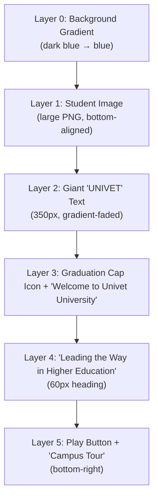

# UNIVET Hero Section — Complete Clone Guide

## 1. Design Breakdown

The UNIVET hero section is a **full-width slider** (960px tall on desktop) with these visual layers stacked on top of each other:



### Color Palette

| Token | Value | Usage |
|---|---|---|
| Primary Dark | `#003A65` | Gradient top, nav, backgrounds |
| Primary Blue | `#0092FF` | Gradient bottom, accents, buttons |
| Secondary | `#FFB800` (approx) | CTA highlights |
| White | `#FFFFFF` | All hero text |
| Text Dark | `#1A1A2E` | Body text outside hero |

---

## 2. Images You Need

From your saved workspace at `d:\saveweb2zip-com-univet-rstheme-com\images\`:

| Image | File | Purpose |
|---|---|---|
| **Hero Student** | Not saved locally — must download from `https://univet.rstheme.com/blue/wp-content/uploads/sites/2/2025/11/bnr-e-main-img1-min.png` | Large student PNG placed at bottom of hero |
| **Graduation Cap** | Not saved locally — must download from `https://univet.rstheme.com/blue/wp-content/uploads/sites/2/2025/12/cap.png` | Small icon next to "Welcome to Univet University" |
| **Logo Dark** | [logo-1-1-min.png](file:///d:/saveweb2zip-com-univet-rstheme-com/images/logo-1-1-min.png) | Header logo (dark version) |
| **Logo White** | [logo-white1-min.png](file:///d:/saveweb2zip-com-univet-rstheme-com/images/logo-white1-min.png) | Header logo (white version) |
| **Marquee Icon** | [m-g-icon1.png](file:///d:/saveweb2zip-com-univet-rstheme-com/images/m-g-icon1.png) | Award icon in marquee ticker |

> [!IMPORTANT]
> The two key hero images (**student PNG** and **cap icon**) are loaded remotely by the Slider Revolution plugin and are NOT saved locally. You need to download them:
> ```
> Student Image: https://univet.rstheme.com/blue/wp-content/uploads/sites/2/2025/11/bnr-e-main-img1-min.png
> Cap Icon: https://univet.rstheme.com/blue/wp-content/uploads/sites/2/2025/12/cap.png
> ```
> Save them to your `images/` folder as `hero-student.png` and `cap-icon.png`.

---

## 3. HTML Structure

```html
<!DOCTYPE html>
<html lang="en">
<head>
    <meta charset="UTF-8">
    <meta name="viewport" content="width=device-width, initial-scale=1.0">
    <title>Univet — Leading the Way in Higher Education</title>
    <meta name="description" content="Welcome to Univet University. Leading the way in higher education with world-class programs and campus life.">
    
    <!-- Google Fonts: Bitter (the original uses this) -->
    <link rel="preconnect" href="https://fonts.googleapis.com">
    <link rel="preconnect" href="https://fonts.gstatic.com" crossorigin>
    <link href="https://fonts.googleapis.com/css2?family=Bitter:wght@400;500;600;700&display=swap" rel="stylesheet">
    
    <link rel="stylesheet" href="css/hero.css">
</head>
<body>

<!-- ============================================
     HERO SECTION
     ============================================ -->
<section id="hero" class="hero-section">
    
    <!-- Background gradient is applied via CSS -->
    
    <!-- Student image (bottom-aligned) -->
    <div class="hero-student-image">
        
    </div>
    
    <!-- Giant "UNIVET" watermark text -->
    <h1 class="hero-watermark" aria-hidden="true">UNIVET</h1>
    
    <!-- Content overlay -->
    <div class="hero-content">
        <!-- Subtitle with cap icon -->
        <div class="hero-subtitle">
            
            <span>Welcome to Univet University</span>
        </div>
        
        <!-- Main heading -->
        <h2 class="hero-heading">Leading the Way in Higher Education</h2>
    </div>
    
    <!-- Campus Tour button (bottom right) -->
    <div class="hero-campus-tour">
        <a href="https://www.youtube.com/watch?v=PUzuTGjvdU0" 
           class="video-play-btn" 
           id="campus-tour-btn"
           aria-label="Play campus tour video">
            <span class="play-icon">▶</span>
        </a>
        <span class="campus-tour-text">Campus Tour</span>
    </div>
    
    <!-- Progress bar at bottom -->
    <div class="hero-progress-bar">
        <div class="progress-fill"></div>
    </div>
</section>

<!-- ============================================
     MARQUEE TICKER (below hero)
     ============================================ -->
<section id="marquee-section" class="marquee-section">
    <div class="marquee-track">
        <div class="marquee-content">
            <!-- Each item alternates between stroke-style and filled text -->
            <div class="marquee-item">
                <p class="stroke-text">2024 best 10 university Awards</p>
                <div class="marquee-icon">
                    
                </div>
            </div>
            <div class="marquee-item">
                <p class="filled-text">2024 best 10 university Awards</p>
                <div class="marquee-icon">
                    
                </div>
            </div>
            <div class="marquee-item">
                <p class="stroke-text">2024 best 10 university Awards</p>
                <div class="marquee-icon">
                    
                </div>
            </div>
            <div class="marquee-item">
                <p class="filled-text">2024 best 10 university Awards</p>
                <div class="marquee-icon">
                    
                </div>
            </div>
        </div>
        <!-- Duplicate for seamless loop -->
        <div class="marquee-content" aria-hidden="true">
            <div class="marquee-item">
                <p class="stroke-text">2024 best 10 university Awards</p>
                <div class="marquee-icon">
                    
                </div>
            </div>
            <div class="marquee-item">
                <p class="filled-text">2024 best 10 university Awards</p>
                <div class="marquee-icon">
                    
                </div>
            </div>
            <div class="marquee-item">
                <p class="stroke-text">2024 best 10 university Awards</p>
                <div class="marquee-icon">
                    
                </div>
            </div>
            <div class="marquee-item">
                <p class="filled-text">2024 best 10 university Awards</p>
                <div class="marquee-icon">
                    
                </div>
            </div>
        </div>
    </div>
</section>

<!-- Video Popup Modal -->
<div id="video-modal" class="video-modal">
    <div class="modal-overlay"></div>
    <div class="modal-content">
        <button class="modal-close" id="modal-close-btn" aria-label="Close video">&times;</button>
        <iframe id="video-iframe" 
                src="" 
                frameborder="0" 
                allow="autoplay; encrypted-media" 
                allowfullscreen>
        </iframe>
    </div>
</div>

<script src="js/hero.js"></script>
</body>
</html>
```

---

## 4. CSS (hero.css)

> [!TIP]
> The original uses the **Bitter** serif font at 350px for the watermark and 60px for the heading. This is the most distinctive part of the design.

```css
/* ============================================
   RESET & BASE
   ============================================ */
*, *::before, *::after {
    margin: 0;
    padding: 0;
    box-sizing: border-box;
}

body {
    font-family: 'Bitter', serif;
    overflow-x: hidden;
    background-color: #F5F5F5;
}

/* ============================================
   HERO SECTION
   ============================================ */
.hero-section {
    position: relative;
    width: 100%;
    height: 960px;
    overflow: hidden;
    
    /* The key gradient: dark navy at top → blue at bottom */
    background: linear-gradient(180deg, rgba(0,58,101,1) 0%, rgba(0,146,255,1) 100%);
}

/* --- Student Image (bottom-aligned, centered) --- */
.hero-student-image {
    position: absolute;
    bottom: 0;
    left: 50%;
    transform: translateX(-50%);
    z-index: 7;
    width: 1920px;
    max-width: none;
    pointer-events: none;
}

.hero-student-image img {
    display: block;
    width: 100%;
    height: auto;
    object-fit: cover;
}

/* --- Giant "UNIVET" Watermark Text --- */
.hero-watermark {
    position: absolute;
    top: 50%;
    left: 50%;
    transform: translate(-50%, -50%);
    z-index: 3;
    
    font-family: 'Bitter', serif;
    font-size: 350px;
    font-weight: 600;
    letter-spacing: 10px;
    line-height: 300px;
    text-align: center;
    white-space: nowrap;
    
    /* THE KEY EFFECT: Gradient text that fades to transparent */
    color: transparent;
    background-image: linear-gradient(180deg, #FFFFFF -37.8%, rgba(255,255,255,0.05) 87.4%);
    -webkit-background-clip: text;
    background-clip: text;
    -webkit-text-fill-color: transparent;
    
    /* Animation: slides up from below with mask reveal */
    opacity: 0;
    animation: watermarkReveal 1.85s cubic-bezier(0.76, 0, 0.24, 1) forwards;
}

/* --- Hero Content (subtitle + heading) --- */
.hero-content {
    position: absolute;
    bottom: 80px;
    left: 18px;
    z-index: 8;
    max-width: 600px;
    padding: 0 20px;
}

.hero-subtitle {
    display: flex;
    align-items: center;
    gap: 12px;
    margin-bottom: 16px;
    
    /* Animation: slides in from left with mask */
    opacity: 0;
    animation: slideInLeft 1.48s cubic-bezier(0.76, 0, 0.24, 1) 1.04s forwards;
}

.hero-subtitle .cap-icon {
    width: 33px;
    height: 33px;
    object-fit: contain;
    
    /* Icon animates separately, slightly before the text */
    opacity: 0;
    animation: slideInFromLeft 1s cubic-bezier(0.76, 0, 0.24, 1) 0.67s forwards;
}

.hero-subtitle span {
    font-family: 'Bitter', serif;
    font-size: 17px;
    font-weight: 500;
    color: #FFFFFF;
    letter-spacing: 1px;
}

.hero-heading {
    font-family: 'Bitter', serif;
    font-size: 60px;
    font-weight: 600;
    color: #FFFFFF;
    line-height: 70px;
    letter-spacing: 1px;
    max-width: 599px;
    
    /* Animation: slides in from left with mask, slightly after subtitle */
    opacity: 0;
    animation: slideInLeft 1.56s cubic-bezier(0.76, 0, 0.24, 1) 1.33s forwards;
}

/* --- Campus Tour (bottom right) --- */
.hero-campus-tour {
    position: absolute;
    bottom: 80px;
    right: 15px;
    z-index: 12;
    display: flex;
    flex-direction: column;
    align-items: center;
    gap: 12px;
    
    /* Animation: slides in from right */
    opacity: 0;
    animation: slideInRight 1s cubic-bezier(0.76, 0, 0.24, 1) 0.99s forwards;
}

.video-play-btn {
    display: flex;
    align-items: center;
    justify-content: center;
    width: 70px;
    height: 70px;
    border-radius: 50%;
    border: 2px solid rgba(255,255,255,0.6);
    background: rgba(255,255,255,0.15);
    cursor: pointer;
    transition: all 0.3s ease;
    text-decoration: none;
    position: relative;
}

.video-play-btn::before {
    content: '';
    position: absolute;
    width: 100%;
    height: 100%;
    border-radius: 50%;
    border: 1px solid rgba(255,255,255,0.3);
    animation: pulse 2s ease-in-out infinite;
}

.video-play-btn:hover {
    background: rgba(255,255,255,0.3);
    transform: scale(1.1);
}

.play-icon {
    color: #FFFFFF;
    font-size: 20px;
    margin-left: 3px; /* optical centering */
}

.campus-tour-text {
    font-family: 'Bitter', serif;
    font-size: 24px;
    font-weight: 600;
    color: #FFFFFF;
    letter-spacing: 1px;
    writing-mode: vertical-lr; /* original is horizontal on desktop */
    writing-mode: horizontal-tb;
}

/* --- Progress Bar (bottom edge) --- */
.hero-progress-bar {
    position: absolute;
    bottom: 0;
    left: 0;
    width: 100%;
    height: 5px;
    background: transparent;
    z-index: 20;
    border-radius: 10px;
}

.progress-fill {
    height: 100%;
    width: 0%;
    background: rgba(255,255,255,0.5);
    border-radius: 10px;
    animation: progressBar 9s linear infinite;
}

/* ============================================
   MARQUEE TICKER SECTION
   ============================================ */
.marquee-section {
    width: 100%;
    overflow: hidden;
    padding: 60px 0;
    background: #F5F5F5;
}

.marquee-track {
    display: flex;
    width: max-content;
    animation: marqueeScroll 25s linear infinite;
}

.marquee-content {
    display: flex;
    align-items: center;
    flex-shrink: 0;
}

.marquee-item {
    display: flex;
    align-items: center;
    gap: 10px;
    flex-shrink: 0;
    padding: 0 20px;
}

.marquee-item p {
    font-family: 'Bitter', serif;
    font-size: 70px;
    font-weight: 600;
    text-transform: uppercase;
    line-height: 60px;
    white-space: nowrap;
}

.marquee-item .filled-text {
    color: #1A1A2E;
}

.marquee-item .stroke-text {
    color: transparent;
    -webkit-text-stroke: 2px #FFB800;
}

.marquee-icon {
    margin: 0 30px;
    flex-shrink: 0;
}

.marquee-icon img {
    width: 60px;
    height: auto;
}

/* ============================================
   VIDEO MODAL
   ============================================ */
.video-modal {
    display: none;
    position: fixed;
    inset: 0;
    z-index: 9999;
    align-items: center;
    justify-content: center;
}

.video-modal.active {
    display: flex;
}

.modal-overlay {
    position: absolute;
    inset: 0;
    background: rgba(0,0,0,0.85);
    cursor: pointer;
}

.modal-content {
    position: relative;
    width: 90%;
    max-width: 900px;
    aspect-ratio: 16/9;
    z-index: 1;
}

.modal-close {
    position: absolute;
    top: -40px;
    right: 0;
    background: none;
    border: none;
    color: #fff;
    font-size: 32px;
    cursor: pointer;
    transition: transform 0.2s;
}

.modal-close:hover {
    transform: scale(1.2);
}

.modal-content iframe {
    width: 100%;
    height: 100%;
    border-radius: 8px;
}

/* ============================================
   KEYFRAME ANIMATIONS
   ============================================ */

/* Watermark "UNIVET" slides up from below */
@keyframes watermarkReveal {
    0% {
        opacity: 0;
        transform: translate(-50%, calc(-50% + 100px));
        clip-path: inset(100% 0 0 0);
    }
    100% {
        opacity: 1;
        transform: translate(-50%, -50%);
        clip-path: inset(0 0 0 0);
    }
}

/* Slide in from left with clip mask */
@keyframes slideInLeft {
    0% {
        opacity: 0;
        transform: translateX(-60px);
        clip-path: inset(0 100% 0 0);
    }
    100% {
        opacity: 1;
        transform: translateX(0);
        clip-path: inset(0 0 0 0);
    }
}

/* Icon slides in from far left */
@keyframes slideInFromLeft {
    0% {
        opacity: 0;
        transform: translateX(-200%);
    }
    100% {
        opacity: 1;
        transform: translateX(0);
    }
}

/* Slide in from right */
@keyframes slideInRight {
    0% {
        opacity: 0;
        transform: translateX(100%);
        clip-path: inset(0 0 0 100%);
    }
    100% {
        opacity: 1;
        transform: translateX(0);
        clip-path: inset(0 0 0 0);
    }
}

/* Pulsing ring on play button */
@keyframes pulse {
    0% { transform: scale(1); opacity: 1; }
    50% { transform: scale(1.3); opacity: 0; }
    100% { transform: scale(1); opacity: 0; }
}

/* Progress bar fills over slideshow duration */
@keyframes progressBar {
    0% { width: 0%; }
    100% { width: 100%; }
}

/* Marquee continuous scroll */
@keyframes marqueeScroll {
    0% { transform: translateX(0); }
    100% { transform: translateX(-50%); }
}

/* ============================================
   RESPONSIVE BREAKPOINTS
   (matching original: 1440, 1024, 778, 480)
   ============================================ */

/* Tablet Landscape (≤1024px) */
@media (max-width: 1024px) {
    .hero-section {
        height: 768px;
    }
    
    .hero-watermark {
        font-size: 250px;
        line-height: 220px;
    }
    
    .hero-heading {
        font-size: 50px;
        line-height: 60px;
        max-width: 470px;
    }
    
    .hero-subtitle span {
        font-size: 16px;
    }
    
    .hero-student-image {
        width: 1590px;
    }
}

/* Tablet Portrait (≤778px) */
@media (max-width: 778px) {
    .hero-section {
        height: 700px;
    }
    
    .hero-watermark {
        font-size: 180px;
        line-height: 160px;
    }
    
    .hero-content {
        left: 27px;
        bottom: 35px;
    }
    
    .hero-heading {
        font-size: 42px;
        line-height: 52px;
        max-width: 399px;
    }
    
    .hero-subtitle span {
        font-size: 15px;
    }
    
    .campus-tour-text {
        font-size: 14px;
    }
    
    .marquee-item p {
        font-size: 50px;
        line-height: 45px;
    }
}

/* Mobile (≤480px) */
@media (max-width: 480px) {
    .hero-section {
        height: 660px;
    }
    
    .hero-watermark {
        font-size: 100px;
        line-height: 90px;
    }
    
    .hero-content {
        left: 0;
        bottom: 28px;
        text-align: center;
        width: 100%;
        padding: 0 20px;
    }
    
    .hero-subtitle {
        justify-content: center;
    }
    
    .hero-subtitle .cap-icon {
        width: 20px;
        height: 20px;
    }
    
    .hero-heading {
        font-size: 36px;
        line-height: 46px;
        max-width: 330px;
        text-align: center;
        margin: 0 auto;
    }
    
    .hero-campus-tour {
        position: relative;
        bottom: auto;
        right: auto;
        margin: 20px auto 0;
    }
    
    .campus-tour-text {
        display: none; /* hidden on mobile in original */
    }
    
    .hero-student-image {
        width: 900px;
    }
    
    .marquee-item p {
        font-size: 36px;
        line-height: 32px;
    }
}
```

---

## 5. JavaScript (hero.js)

The original uses GSAP (TweenMax + ScrollTrigger) via Slider Revolution. Our pure JS version replicates the core behaviors:

```javascript
/* ============================================
   HERO SECTION — JavaScript
   ============================================ */

document.addEventListener('DOMContentLoaded', () => {
    
    // ------------------------------------------------
    // 1. VIDEO POPUP (Campus Tour button)
    // ------------------------------------------------
    const playBtn = document.getElementById('campus-tour-btn');
    const modal = document.getElementById('video-modal');
    const iframe = document.getElementById('video-iframe');
    const closeBtn = document.getElementById('modal-close-btn');
    const overlay = modal.querySelector('.modal-overlay');
    
    function openVideo() {
        // Extract video ID and set embed URL with autoplay
        const videoUrl = playBtn.getAttribute('href');
        const videoId = videoUrl.split('v=')[1]?.split('&')[0];
        iframe.src = `https://www.youtube.com/embed/${videoId}?autoplay=1`;
        modal.classList.add('active');
        document.body.style.overflow = 'hidden';
    }
    
    function closeVideo() {
        modal.classList.remove('active');
        iframe.src = '';
        document.body.style.overflow = '';
    }
    
    playBtn.addEventListener('click', (e) => {
        e.preventDefault();
        openVideo();
    });
    
    closeBtn.addEventListener('click', closeVideo);
    overlay.addEventListener('click', closeVideo);
    
    document.addEventListener('keydown', (e) => {
        if (e.key === 'Escape' && modal.classList.contains('active')) {
            closeVideo();
        }
    });
    
    // ------------------------------------------------
    // 2. INTERSECTION OBSERVER for replay animations
    //    (when hero scrolls back into view)
    // ------------------------------------------------
    const hero = document.getElementById('hero');
    const animatedElements = hero.querySelectorAll(
        '.hero-watermark, .hero-subtitle, .hero-subtitle .cap-icon, .hero-heading, .hero-campus-tour'
    );
    
    const heroObserver = new IntersectionObserver((entries) => {
        entries.forEach(entry => {
            if (entry.isIntersecting) {
                // Re-trigger animations by removing and re-adding them
                animatedElements.forEach(el => {
                    el.style.animation = 'none';
                    el.offsetHeight; // force reflow
                    el.style.animation = '';
                });
            }
        });
    }, { threshold: 0.3 });
    
    heroObserver.observe(hero);
    
    // ------------------------------------------------
    // 3. PARALLAX EFFECT on student image (optional)
    //    Subtle upward shift on scroll for depth feel
    // ------------------------------------------------
    const studentImg = document.querySelector('.hero-student-image');
    
    window.addEventListener('scroll', () => {
        const scrollY = window.scrollY;
        const heroHeight = hero.offsetHeight;
        
        if (scrollY < heroHeight) {
            const parallaxOffset = scrollY * 0.15;
            studentImg.style.transform = `translateX(-50%) translateY(${parallaxOffset}px)`;
        }
    }, { passive: true });
    
});
```

---

## 6. Key Design Details Explained

### The "UNIVET" Gradient Text Effect
This is the hero's signature visual. A 350px `Bitter` serif font with a vertical gradient from **solid white** at the top to **near-transparent** at the bottom:

```css
background-image: linear-gradient(180deg, #FFFFFF -37.8%, rgba(255,255,255,0.05) 87.4%);
-webkit-background-clip: text;
-webkit-text-fill-color: transparent;
```

The `-37.8%` start position means the solid white extends *above* the text's bounding box, ensuring the top portion is fully opaque before fading.

### Animation Timing Sequence
The original Slider Revolution config reveals layers in this order:

| Delay | Duration | Element | Direction |
|---|---|---|---|
| 0ms | 1850ms | "UNIVET" watermark | Slide up with mask |
| 670ms | 1000ms | Cap icon | Slide from left |
| 1040ms | 1480ms | "Welcome to Univet University" | Slide from left with mask |
| 1330ms | 1560ms | "Leading the Way..." heading | Slide from left with mask |
| 990ms | 1000ms | Play button + "Campus Tour" | Slide from right with mask |

All animations use `power3.inOut` easing (GSAP), which maps closely to `cubic-bezier(0.76, 0, 0.24, 1)` in CSS.

### Progress Bar
The original has a thin 5px bar at the bottom that fills over the slide duration, then resets. Our CSS `@keyframes progressBar` replicates this with a 9-second cycle.

---

## 7. File Structure

```
your-project/
├── index.html
├── css/
│   └── hero.css
├── js/
│   └── hero.js
└── images/
    ├── hero-student.png     ← download from UNIVET
    ├── cap-icon.png         ← download from UNIVET
    ├── logo-white1-min.png  ← already in workspace
    └── m-g-icon1.png        ← already in workspace (for marquee)
```

---

## 8. Differences from the Original

| Feature | Original | Our Clone |
|---|---|---|
| Slider engine | Slider Revolution 6.7 (commercial plugin, ~$30) | Pure CSS animations |
| Animation library | GSAP (TweenMax) | CSS `@keyframes` + JS IntersectionObserver |
| Multiple slides | 2 slides with transitions | Single hero (expandable) |
| Video popup | Magnific Popup jQuery plugin | Vanilla JS modal |
| Marquee | GSAP-powered marquee slider | CSS `@keyframes` infinite scroll |
| Fonts | Loaded from WordPress/Google Fonts | Google Fonts CDN |

> [!NOTE]
> The original site uses heavy WordPress/Elementor infrastructure. Our clone achieves the same visual result with ~200 lines of CSS and ~60 lines of JS — zero dependencies.

---

## 9. Quick Start Checklist

- [ ] Download the 2 hero images (student PNG + cap icon)
- [ ] Copy `m-g-icon1.png` and `logo-white1-min.png` from your workspace
- [ ] Create `hero.css` and `hero.js` from the code above
- [ ] Create `index.html` from the HTML structure above
- [ ] Open in browser and verify animations play on load
- [ ] Test responsive at 1024px, 778px, and 480px breakpoints

> [!TIP]
> If you want me to **build all these files** directly in your workspace and run it locally, just say the word and I'll create everything ready to open.
